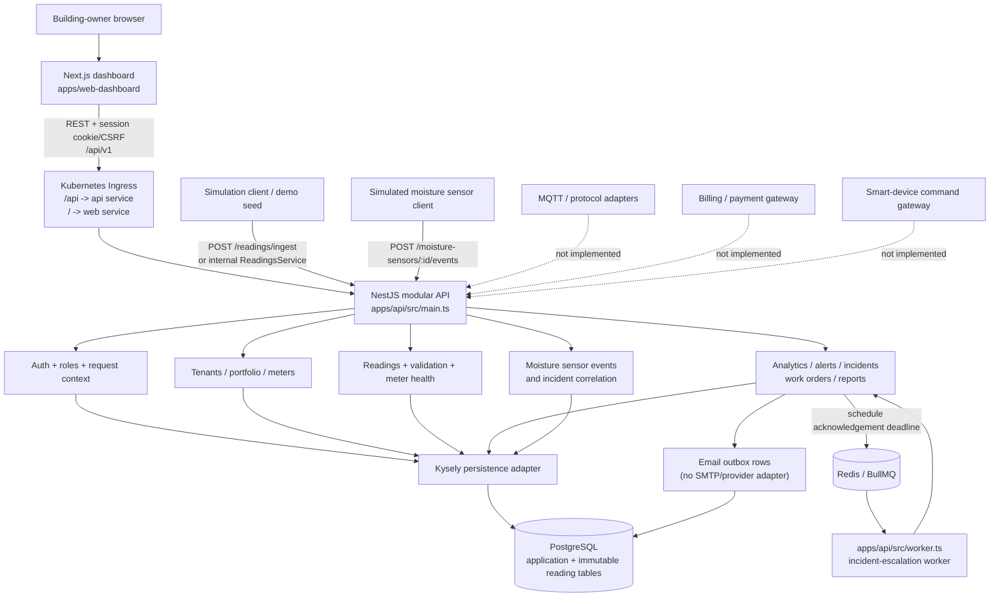
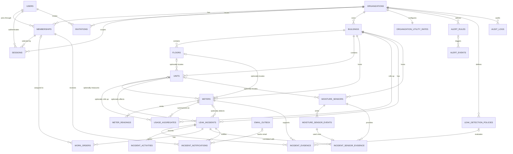
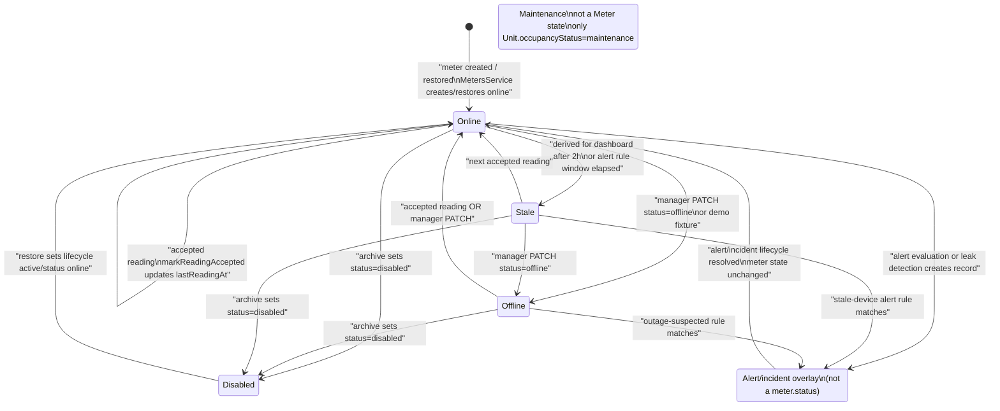

# IoT Management System Design and Architecture

> **Repository basis:** current working tree, analyzed 2026-07-04. The document describes executable code and SQL migrations under `apps/`, `packages/`, and `deploy/`. It intentionally distinguishes implemented behavior from design-spec roadmap items.

## Scope and evidence boundary

This is a TypeScript monorepo for an operational smart-utilities dashboard. Its core implementation is water/electric meter monitoring, usage/cost estimation, water-leak response, and **simulated** moisture sensors. The current baseline specification is [the SaaS design spec](superpowers/specs/2026-06-29-iot-utilities-saas-design.md); the implementation has since added the water-incident, work-order, notification, and moisture-correlation paths.

The following requested concepts are **not implemented** and must not be inferred from enum names, planned design text, or Kubernetes labels:

- No billing, subscription, invoice, tenant statement, payment database table, Stripe SDK, payment gateway class, or payment webhook exists. `CostEstimateService` produces an estimated utility cost only.
- No MQTT client/broker, HTTP device gateway, Modbus/LoRaWAN/Zigbee adapter, or protocol handler exists. `Meter.source` may be `gateway`, `direct_api`, or `mqtt`, but all actual meter intake is authenticated REST.
- No smart-device command model or “turn off” endpoint exists. Meters are monitored; moisture sensors emit `dry`/`wet` events. Neither is actuated.
- There is no scheduled aggregation or stale-device cron. Aggregation and alert evaluation are authenticated REST operations; the one active BullMQ consumer handles incident acknowledgement escalation.

## 1. Architectural overview & service map

### Implemented architectural pattern

`apps/api` is a **modular NestJS monolith**, not a set of independently owned microservices. `apps/api/src/main.ts` applies the `/api/v1` global prefix and creates one `AppModule`; `apps/api/src/app.module.ts` imports the domain modules into that same process. `apps/api/src/worker.ts` starts a separate process from the same application module and uses BullMQ only for the `incident-escalation` queue.

The deployment topology in `deploy/kubernetes/base/` splits runtime workloads into API, dashboard, worker, PostgreSQL, and Redis deployments/services, but the domain code remains one deployable API codebase. The worker is therefore a process boundary, not an independently designed billing, ingestion, or device-management microservice.

| Runtime area                   | Implementing files/modules                                                                                               | Responsibility actually present                                                                                                                                            |
| ------------------------------ | ------------------------------------------------------------------------------------------------------------------------ | -------------------------------------------------------------------------------------------------------------------------------------------------------------------------- |
| Web dashboard                  | `apps/web-dashboard/app`, `components`, `features`, `lib/auth-client.ts`                                                 | Next.js operational UI. Browser calls `/api/v1`; TanStack Query retries queries once in `components/query-provider.tsx`.                                                   |
| REST/API composition           | `apps/api/src/main.ts`, `app.module.ts`                                                                                  | NestJS REST API, CORS for local origins, global error filter, request-security headers, auth and role guards.                                                              |
| Meter ingestion                | `readings/readings.controller.ts`, `readings.service.ts`, `reading-validation.service.ts`                                | Authenticated `POST /api/v1/readings/ingest`, validation, tenant-scoped meter lookup, duplicate detection, immutable reading insert, meter-health update, leak evaluation. |
| Meter and portfolio management | `meters/*`, `portfolio/*`, `tenants/*`                                                                                   | Organization-scoped buildings, floors, units, meters, lifecycle/archive state, membership roles.                                                                           |
| Smart-device monitoring        | `meters/meter-health.service.ts`, `moisture-sensors/*`                                                                   | Meter status/last reading and simulated moisture sensor inventory/events; no device command or device protocol adapter.                                                    |
| Analytics and estimated cost   | `analytics/aggregation.service.ts`, `usage-query.service.ts`, `cost-estimate.service.ts`, `settings/settings.service.ts` | Converts readings into hourly/day/month `usage_aggregates`; multiplies water/electric usage by organization rates.                                                         |
| Alert and incident response    | `alerts/*`, `incidents/*`, `work-orders/*`, `notifications/*`, `email/*`                                                 | Generic alert rules/events plus water-leak incident lifecycle, work orders, in-app/email-outbox notifications, and escalation jobs.                                        |
| Persistence                    | `database/database.service.ts`, `persistence/postgres-persistence.service.ts`, `db/migrations/*.sql`                     | Kysely over `pg` against PostgreSQL. The production binding is `PERSISTENCE_SERVICE -> PostgresPersistenceService`.                                                        |
| Async work                     | `jobs/queues.ts`, `worker.ts`, `notifications/incident-escalation.service.ts`                                            | Redis/BullMQ delayed acknowledgement-deadline processing with three exponential-backoff attempts. `analyticsAggregation` is named but has no producer or worker handler.   |

Tenant isolation is a cross-cutting boundary. `AuthGuard` resolves a session or bearer token into `RequestContext`; application services pass `context.organization.id` to persistence methods. The database also places `organization_id` on customer-owned tables, while controller role decorators restrict mutation routes primarily to `owner` and `manager`.

### Visual component diagram



### Service responsibility answers

1. **Meter data ingestion:** `ReadingsController.ingest()` and `ReadingsService.ingest()` in `apps/api/src/readings/`. Simulations (`SimulationsService.run()` and `DemoSeedService.seed()`) generate readings but deliberately reuse that service path.
2. **Billing/payments:** no service exists. The closest implemented path is `AggregationService.aggregate()` -> `CostEstimateService.estimate()` -> `usage_aggregates.cost_estimate`, read by `ReportsService.monthlyUsage()`.
3. **Smart device management:** `MetersService` manages meter inventory/status, and `MoistureSensorsService` manages simulated moisture sensors and events. There is no protocol abstraction that dispatches commands to hardware.

## 2. IoT data ingestion & protocol pipeline

### Meter-reading entry points and code path

The external meter entry point is `POST /api/v1/readings/ingest` in `apps/api/src/readings/readings.controller.ts`. It has `AuthGuard`, `RolesGuard`, and `@Roles("owner", "manager")`; the rate limiter permits 10 ingestion requests per organization/user per minute. The DTO type is `IngestReadingDto` and maps to `IngestReadingRequest`:

```json
{
  "meterExternalId": "sim-water-unit-101",
  "measuredAt": "2026-07-04T12:00:00.000Z",
  "utilityType": "water",
  "value": 12844.25,
  "unit": "gallon",
  "readingKind": "cumulative"
}
```

`ReadingsService.ingest()` executes the following ordered path:

1. Looks up the meter by `(context.organization.id, meterExternalId)`. A missing meter produces `UNKNOWN_METER` (404), so an external ID from another tenant cannot resolve.
2. `ReadingValidationService.validate()` rejects negative values, meter/utility mismatch, incompatible units (`water -> gallon|liter`, `electric -> kwh`), invalid timestamps, timestamps before `2026-01-01T00:00:00.000Z`, and a missing meter building.
3. Looks up an existing reading by `(organization_id, meter_id, measured_at)`. A hit returns `200 { accepted: false, duplicate: true }`; no new row is created.
4. Inserts a `meter_readings` row through `PostgresPersistenceService.createReading()`, defaulting `quality` to `good`. Migration `0003_phase5_meter_readings.sql` enforces the same `(meter_id, measured_at)` uniqueness at the database boundary.
5. `MeterHealthService.markReadingAccepted()` sets the meter to `online` and updates `last_reading_at`.
6. The synchronous post-acceptance hooks run `LeakDetectionService.evaluateAcceptedReading()` and `LeakBaselineDetectionService.evaluateAcceptedReading()`. Both only process good, interval water readings; either can create/update a `leak_incidents` investigation and evidence.

Simulation is not a competing ingestion transport. `POST /api/v1/simulations/run` in `simulations.controller.ts` produces profiles in `simulated-usage-profile.ts` and calls `ReadingsService.ingest()` for every generated reading. `POST /api/v1/simulations/demo-seed` calls the same service from `DemoSeedService`, then calculates hour/day/month aggregates.

### Moisture-sensor event path

The only other device-like ingress is `POST /api/v1/moisture-sensors/:sensorId/events`, implemented by `MoistureSensorsController.ingest()` and `MoistureSensorsService.ingest()`. It accepts `dry` or `wet`, validates timestamp and tenant-owned sensor, and creates an idempotent `(sensor_id, measured_at)` event. A `wet` event first attempts to correlate with a non-resolved `meter_anomaly` leak incident in the same building/unit within `incident_correlation_settings.moisture_correlation_window_minutes`. If none is found, it opens a `moisture_sensor` leak incident and queues notifications. This is event correlation, not actuator control.

There are no MQTT callbacks, topic subscriptions, gateway HTTP callbacks, or command handlers in `apps/api`; `Meter.source` is inventory metadata rather than a runtime protocol selector.

### Meter-payload sequence

```mermaid
sequenceDiagram
  autonumber
  actor Producer as "Authenticated client or simulation"
  participant C as "ReadingsController\nPOST /readings/ingest"
  participant A as "AuthGuard + RolesGuard"
  participant S as "ReadingsService"
  participant V as "ReadingValidationService"
  participant P as "PostgresPersistenceService"
  participant H as "MeterHealthService"
  participant L as "Leak/Baseline Detection"
  participant DB as "PostgreSQL"

  Producer->>C: IngestReadingDto
  C->>A: authenticate session/bearer and role check
  A-->>C: RequestContext (organization, membership, user)
  C->>C: rate limit 10/min per organization/user
  C->>S: ingest(context, dto)
  S->>P: findMeterByExternalId(orgId, externalId)
  P->>DB: tenant-scoped SELECT meters
  DB-->>P: meter
  P-->>S: meter
  S->>V: validate(dto + meter)
  V->>P: findBuildingById(meter organization/building)
  P->>DB: tenant-scoped SELECT building
  DB-->>P: building
  V-->>S: valid, or ApiError 400
  S->>P: findReadingByMeterAndMeasuredAt(orgId, meterId, measuredAt)
  P->>DB: tenant-scoped duplicate SELECT
  alt duplicate exists
    DB-->>P: existing reading
    P-->>S: duplicate
    S-->>C: accepted=false, duplicate=true
    C-->>Producer: HTTP 200
  else new reading
    S->>P: createReading(... quality=good)
    P->>DB: INSERT meter_readings
    DB-->>P: stored row
    P-->>S: reading
    S->>H: markReadingAccepted()
    H->>P: updateMeter(lastReadingAt, status=online)
    P->>DB: UPDATE meters
    S->>L: evaluateAcceptedReading() twice
    L->>P: read policies/readings; maybe incident/evidence
    P->>DB: SELECT/INSERT incident data
    S-->>C: accepted=true, duplicate=false
    C-->>Producer: HTTP 201
  end
```

## 3. Data model & schema design

### Physical data architecture

The authoritative relational schema is the ordered SQL set in `apps/api/db/migrations/`; Kysely's typed projection is `apps/api/src/database/schema.ts`. `DatabaseService` creates a `pg` pool and Kysely dialect. Application persistence is the `PERSISTENCE_SERVICE` token bound to `PostgresPersistenceService` in `persistence/persistence.module.ts`; `InMemoryPersistenceService` is available for tests but is not the runtime binding.

`organization_id` is stored on all tenant-owned operational tables and is included in service queries. SQL foreign keys protect ownership trees only through their referenced records; they do not by themselves guarantee that a child row's `organization_id` matches its parent. The service layer supplies that tenant scope and validates assignments.

| Domain                 | Tables and code-defined purpose                                                                                                     | Important integrity rules                                                                                                                                                                         |
| ---------------------- | ----------------------------------------------------------------------------------------------------------------------------------- | ------------------------------------------------------------------------------------------------------------------------------------------------------------------------------------------------- |
| Tenant and access      | `organizations`, `users`, `memberships`, `sessions`, `invitations`, `password_reset_tokens`                                         | `memberships` is unique per `(organization_id, user_id)`; sessions bind user, organization, and membership; roles are owner/manager/viewer/tenant.                                                |
| Property portfolio     | `buildings`, `floors`, `units`                                                                                                      | All belong to an organization; floors belong to buildings; units belong to a building and optionally a floor; each has active/archived lifecycle columns after migration `0008`.                  |
| Meter telemetry        | `meters`, `meter_readings`, `usage_aggregates`, `organization_utility_rates`                                                        | Meter external ID is unique within organization. Reading identity is unique per `(meter_id, measured_at)` and values cannot be negative. Aggregates are unique per meter/time window/period type. |
| Generic alerting       | `alert_rules`, `alert_events`                                                                                                       | Rules support organization/building/unit/meter scope via `scope_type` plus non-FK `scope_id`; events optionally reference `rule_id`.                                                              |
| Leak operations        | `leak_detection_policies`, `leak_incidents`, `incident_evidence`, `incident_activities`, `work_orders`                              | Incidents reference building and optionally unit/meter; evidence links readings to an incident; work orders and activities cascade-delete with their incident.                                    |
| Moisture correlation   | `moisture_sensors`, `moisture_sensor_events`, `incident_sensor_evidence`, `incident_correlation_settings`, `leak_baseline_settings` | Moisture sensors are currently `source = simulated`; events are unique `(sensor_id, measured_at)`; one sensor event can be evidence for at most one incident.                                     |
| Notification and audit | `incident_responder_settings`, `incident_notifications`, `email_outbox`, `audit_logs`, `schema_migrations`                          | Notification dedupe is unique per organization/recipient/channel/key. Email outbox stores generated messages, not delivery-provider responses.                                                    |

### Entity relationships



`scope_id` in `alert_rules` and `leak_detection_policies` is deliberately polymorphic rather than a foreign key. `incident_evidence.reading_ids` is JSONB rather than a normalized join table. These relationships are interpreted by `AlertEvaluatorService`, `LeakDetectionService`, and persistence queries, not enforced as direct SQL FKs.

### No invoice relationship

There is no `Tenant` entity distinct from a user membership, no `Invoice`, no `Payment`, and no `Subscription` in `DatabaseSchema` or migrations. “Apartment” maps to `units`; “building-level shared meter” maps to a `meters` row whose `unit_id` is null. Estimated monthly rows are calculated on demand by `ReportsService.monthlyUsage()` from `usage_aggregates`, grouped by `(buildingId, unitId ?? "shared")`; they are not invoices.

## 4. Automated core flows (code trace)

### Meter-to-cash: implemented as meter-to-estimated-cost

The exact implemented pipeline is below. It stops before billing because the codebase contains no cash collection, payment reconciliation, invoice creation, or payment-failure state.

| Step                         | Code path                                                                                                                  | Data/result                                                                                                                                                                                                                    |
| ---------------------------- | -------------------------------------------------------------------------------------------------------------------------- | ------------------------------------------------------------------------------------------------------------------------------------------------------------------------------------------------------------------------------ |
| 1. Accept reading            | `ReadingsController.ingest()` -> `ReadingsService.ingest()`                                                                | Inserts immutable `meter_readings` record after tenant, unit/value/time, and duplicate checks.                                                                                                                                 |
| 2. Produce readings for demo | `SimulationsController.run()` -> `SimulationsService.run()` -> `generateSimulatedReadings()` -> `ReadingsService.ingest()` | Simulation deliberately takes the same validation/persistence path. `DemoSeedService.seed()` also uses it.                                                                                                                     |
| 3. Aggregate                 | `POST /api/v1/analytics/aggregate` -> `AnalyticsController.aggregate()` -> `AggregationService.aggregate()`                | For each tenant meter, ignores `invalid`/`duplicate` readings; interval readings contribute directly and cumulative readings become successive deltas. Results replace aggregate rows for the requested hour/day/month period. |
| 4. Price                     | `AggregationService` -> `CostEstimateService.estimate()`                                                                   | Applies `organization_utility_rates.water_per_gallon` or `.electric_per_kwh`. Defaults are `$0.005/gallon` and `$0.15/kWh` only if no provider override is injected.                                                           |
| 5. Present/export            | `UsageQueryService`, `DashboardService`, `ReportsService.monthlyUsage()` and `.monthlyUsageCsvForContext()`                | Dashboard queries trends, building/unit breakdowns; reports return JSON or CSV with `estimatedCost`.                                                                                                                           |

Aggregation is demand-triggered. `DemoSeedService.seed()` invokes all hour/day/month aggregates as part of seeding. The named `analytics-aggregation` queue in `jobs/queues.ts` has no enqueue code or BullMQ `Worker`, so it is not an automated aggregate runner.

### Incident automation and background worker

When an accepted good interval water reading satisfies a leak policy, `LeakDetectionService` creates one open incident per policy/meter (or adds evidence to the existing one). It computes excess water/cost, writes activity/audit records, and calls `IncidentNotificationsService.notifyIncidentOpened()`.

`IncidentNotificationsService` creates in-app notifications and, when enabled, an `email_outbox` record through `OutboxEmailService`. For warning/critical incidents it schedules a delayed `incident-ack-{incidentId}` BullMQ job. `apps/api/src/worker.ts` is the only active consumer: it loads `IncidentEscalationService.process()`, which sends overdue notifications only if the incident remains `open` and warning/critical. The queue config retries failed jobs three times with 1-second exponential backoff and retains failed jobs.

### Smart-device protocol abstraction and unified commands

No such implementation exists. The code currently provides only:

- Meter inventory configuration: `POST/PATCH /api/v1/meters` in `MetersController` / `MetersService`.
- Meter status updates through that same management API, plus automatic `online` transition after a successful reading.
- Simulated moisture sensor management: `POST/PATCH /api/v1/moisture-sensors`.
- Moisture events: `POST /api/v1/moisture-sensors/:sensorId/events`.

`Meter.source` accepts `simulated | gateway | direct_api | mqtt` in the schema, but neither `MetersService` nor `ReadingsService` selects a transport implementation from it. There is no command DTO, adapter interface, command queue, device credential model, command audit record, acknowledgement callback, or `turn off` endpoint. Adding a device-control abstraction would be a new architecture/data/API decision, not documentation of existing behavior.

## 5. System state & error handling

### Actual handling by failure mode

| Scenario                                | Current behavior and evidence                                                                                                                                                                                                        | Limitation/callout                                                                                                                                                                                                      |
| --------------------------------------- | ------------------------------------------------------------------------------------------------------------------------------------------------------------------------------------------------------------------------------------ | ----------------------------------------------------------------------------------------------------------------------------------------------------------------------------------------------------------------------- |
| Offline meter                           | `Meter.status` can be manually set with `PATCH /meters/:meterId`; simulations can skip selected meters when scenario is `offline`. `AlertEvaluatorService` raises `outage_suspected` only when stored status is `offline`.           | No heartbeat worker or inbound protocol adapter automatically writes `offline`.                                                                                                                                         |
| Stale meter                             | `MeterHealthService` marks a successful read `online`. `UsageQueryService.getDeviceHealth()` **computes** `stale` when an online meter’s `lastReadingAt` is older than two hours. Alert evaluation uses each rule’s `windowMinutes`. | The two-hour dashboard state is not persisted. There is no cron that changes `meters.status` to `stale`.                                                                                                                |
| Disabled / archive                      | `MetersService.archive()` updates meter lifecycle to `archived` and status to `disabled`; `restore()` returns it to active/online. Moisture sensor ingestion rejects disabled sensors with `MOISTURE_SENSOR_DISABLED` (409).         | Meter-reading ingestion does not explicitly reject a disabled/archived meter; it validates lookup/type/building then accepts it.                                                                                        |
| Leak/alert condition                    | Leak services create `leak_incidents`; generic alert evaluation creates `alert_events`. Both are parallel operational states, not `Meter.status` enum values.                                                                        | A meter has no `alert` status, so alerts must be read from incident/alert resources.                                                                                                                                    |
| Network timeout/dependency outage       | `HealthService` catches PostgreSQL `select 1` failure and Redis TCP errors/timeouts (750 ms), reporting each as `degraded` while returning API `status: ok`.                                                                         | No outbound IoT/network client exists, and health degradation does not circuit-break writes or queue ingestion.                                                                                                         |
| Notification worker failure             | `IncidentEscalationQueueService.schedule()` configures `attempts: 3`, exponential 1-second backoff, and keeps failed jobs. Worker startup/fatal errors log and set a nonzero exit code.                                              | Only incident escalation has queue retry semantics; no generic job recovery, DLQ workflow, or email delivery consumer exists.                                                                                           |
| Payment failure                         | Not applicable: no payment initiation or payment gateway integration exists.                                                                                                                                                         | No payment status/retry/webhook state is modeled.                                                                                                                                                                       |
| Expected API/domain error               | Services throw `ApiError` for expected validation/auth/tenant errors. Global `HttpExceptionFilter` returns `{ error: { code, message, requestId, method, path, statusCode, timestamp } }`; 5xx errors are structured-logged.         | It does not include field-level validation detail in its response payload.                                                                                                                                              |
| Duplicate ingestion race                | Service checks for a duplicate before insert; database uniquely constrains `(meter_id, measured_at)`.                                                                                                                                | The check-then-insert is not transactionally converted to `ON CONFLICT`; two concurrent first writers can cause a PostgreSQL unique violation that becomes generic HTTP 500 instead of the intended duplicate response. |
| Database deadlock/serialization/timeout | Migrations use an advisory lock and run each migration inside `BEGIN`/`COMMIT`, rolling back the migration transaction on error. `resetDemoData()` also uses a transaction.                                                          | Normal persistence operations have no SQLSTATE-specific catch, deadlock retry, serialization retry, or request timeout policy. A database deadlock escapes through the global filter as `INTERNAL_SERVER_ERROR` (500).  |

### Meter connectivity and alert state diagram

`online`, `offline`, `stale`, and `disabled` are the complete `Meter.status` enum in `packages/types/src/domain.ts`. “Alert” is modeled separately as `alert_events`/`leak_incidents`, and “Maintenance” exists for `Unit.occupancyStatus`, not meter connectivity. The diagram therefore preserves the labels requested while showing their implemented semantics rather than inventing state transitions.



## API and deployment reference

All controller routes below are under `/api/v1`, established in `apps/api/src/main.ts`.

| Area                          | Implemented routes (representative complete operational surface)                                                                                                                                          |
| ----------------------------- | --------------------------------------------------------------------------------------------------------------------------------------------------------------------------------------------------------- |
| Health/auth/tenant            | `GET /health`; `POST /auth/login`, `/auth/logout`, `/auth/change-password`, `/auth/forgot-password`, `/auth/reset-password`; `GET /auth/me`, `/auth/csrf`; organization/membership and invitation routes. |
| Portfolio/meters/readings     | Buildings, floors, units, and meters support create/list/get/update plus archive/restore where applicable. `POST /readings/ingest`; `GET /meters/:meterId/readings`.                                      |
| Simulation and analytics      | `POST /simulations/demo-seed`, `POST /simulations/run`; `POST /analytics/aggregate`; dashboard summary/overview/trends/buildings/units/device-health/alerts GET routes.                                   |
| Alerts and water response     | Alert rule CRUD/evaluate/acknowledge/resolve; leak incident list/manual/create/lifecycle/note/detail; work-order create/list/get/update; notifications and responder settings.                            |
| Moisture / reports / settings | Moisture sensor CRUD/events and correlation settings; monthly usage/leak response JSON and export; utility rate get/update; audit events and OpenAPI JSON.                                                |

Kubernetes resources in `deploy/kubernetes/base/kustomization.yaml` deploy two API replicas, two dashboard replicas, one worker replica, a migration `Job`, PostgreSQL, Redis, services, ingress, and network policy. The Ingress routes `/api` to `api-service` and `/` to `web-service`. API readiness/liveness request `GET /api/v1/health`; worker probes only validate that `REDIS_URL` parses, not that it can consume a job.

## Manual verification

This document describes code; it does not change runtime behavior. To validate the trace against a local environment:

1. Start PostgreSQL and Redis, then migrate and seed using the repository commands documented in [local deployment instructions](deployment/local.md): `pnpm db:migrate`, `pnpm seed:demo`, `pnpm dev:api`, and `pnpm dev:web`.
2. Authenticate with the seeded owner account and call `GET http://127.0.0.1:3001/api/v1/health`. Expected result: `status: "ok"` and PostgreSQL/Redis dependency status fields.
3. Use `POST /api/v1/readings/ingest` twice with the same meter external ID and `measuredAt`. Expected result: first request is 201 with `accepted: true`; second is 200 with `duplicate: true` when executed serially.
4. Call `POST /api/v1/analytics/aggregate` with `{ "periodType": "month" }`, then `GET /api/v1/reports/monthly-usage?month=2026-06`. Expected result: rows expose `estimatedCost`, with no invoice/payment identifier.
5. Run `POST /api/v1/simulations/run` with scenario `offline` and a selected `offlineMeterExternalIds` entry. Expected result: no generated readings for that meter; its `offline` state still requires a management update or demo fixture for outage alert logic.
6. Inspect the API schema at `GET /api/v1/openapi.json` and the deployed resources with `kubectl get deploy,job,pod -n iot-management` after applying an overlay. Expected result: API, web, and worker are separate workloads; only the worker consumes the incident escalation queue.

### Verification performed for this document

- Inspected API bootstrap/modules, controllers, services, worker/queue code, Kysely schema, all numbered SQL migrations, dashboard client paths, package scripts, and Kubernetes manifests.
- Confirmed via repository-wide search that no Stripe/payment/billing implementation, MQTT/protocol implementation, smart-device command path, or database deadlock retry handler exists.
- The document’s Mermaid diagrams were written as standard Mermaid `graph TD`, `sequenceDiagram`, `erDiagram`, and `stateDiagram-v2` blocks. No running environment or live API was changed or exercised while producing this documentation.
